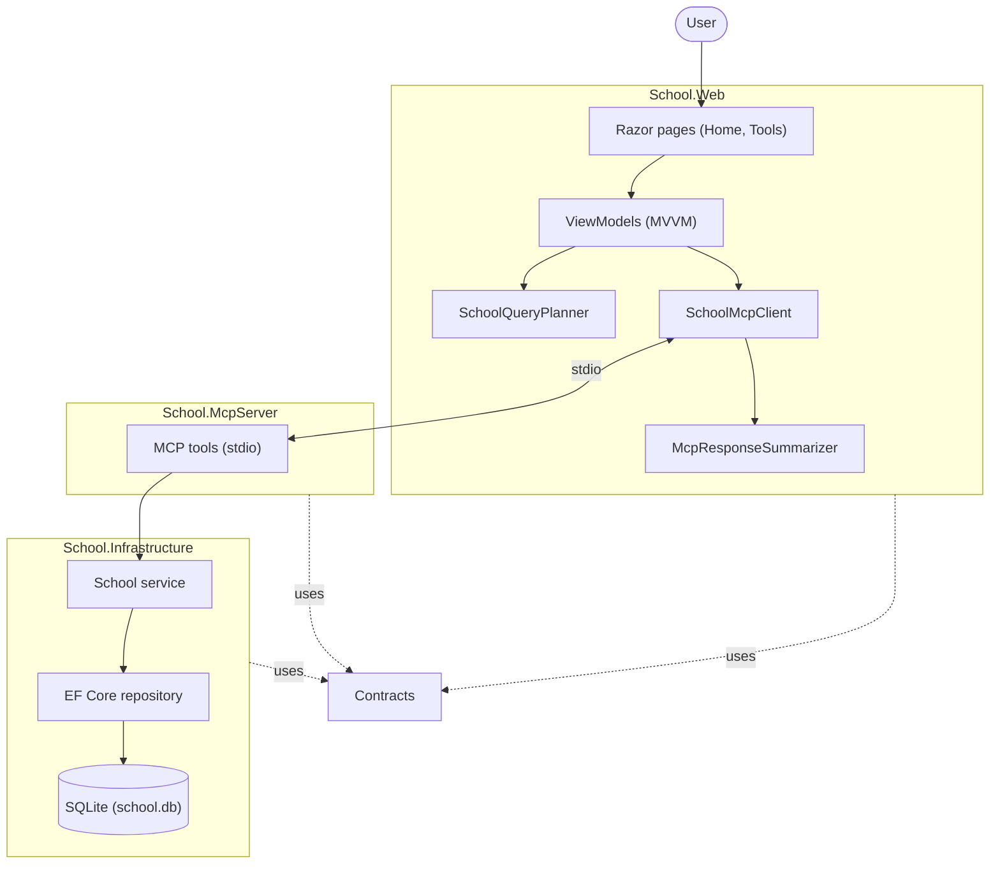

# School Chat

School Chat is a Blazor Server application that answers questions about school courses, professors, students, and classrooms. The web app connects to a local Model Context Protocol (MCP) server, which exposes school data lookup tools backed by SQLite. Responses are formatted locally by default; an optional OpenAI-compatible chat completions endpoint can summarize them in natural language.

## Solution structure

- `src/School.Web` � Interactive Blazor Server UI, chat flow, and MCP client. The home page is the chat; `/tools` shows tools discovered from the MCP server.
- `src/School.McpServer` � MCP server using standard input/output transport and exposing school lookup tools.
- `src/School.Infrastructure` � Entity Framework Core data access, SQLite setup, and sample-data seeding.
- `src/School.Contracts` � Data transfer objects shared between projects.
- `src/tests/School.Tests` � NUnit tests for the web view models, school service, and repository.
- `SchoolChat.sln` � Solution file.




## Requirements

- .NET 9 SDK
- Internet access and an API key only if you want AI-generated summaries (optional)


## Run the application

From the repository root, build and run the web project:

```powershell
dotnet run --project src/School.Web/School.Web.csproj
```

Open the local URL printed in the console. The web project builds and copies the MCP server into its output directory; it starts the server automatically when the app runs. The server creates `school.db` in the process working directory and seeds it with sample school data on first startup.

To use AI-generated summaries, configure an API key before starting the web app. For example, in PowerShell:

```powershell
$env:Ai__ApiKey = "your-api-key"
dotnet run --project src/School.Web/School.Web.csproj
```

The default AI configuration uses `https://api.openai.com/v1/chat/completions` and the `gpt-4o-mini` model. You can override these settings with `Ai__Endpoint` and `Ai__Model`. Without an API key, the application formats the MCP tool results directly and does not require an AI service.

### Request flow

1. The user submits a question in the interactive Blazor chat.
2. The query planner chooses a school lookup tool and prepares its arguments.
3. The MCP client calls the local MCP server over standard input/output (stdio).
4. The server tool delegates to the school service and repository, which read from SQLite through Entity Framework Core.
5. The result is summarized by the configured AI service when available, or formatted locally, then shown in the chat.


## Projects


| Project                     | Responsibility                                                                                            |
| --------------------------- | --------------------------------------------------------------------------------------------------------- |
| `src/School.Web`            | Interactive Blazor Server app, chat and tools pages, query planning, MCP client, and response formatting. |
| `src/School.McpServer`      | Stdio MCP server and school lookup tools.                                                                 |
| `src/School.Infrastructure` | EF Core/SQLite persistence, repository, schema setup, and sample-data seeding.                            |
| `src/School.Contracts`      | DTOs shared across application layers.                                                                    |
| `src/tests/School.Tests`    | NUnit tests for view models, service behavior, and repository queries.                                    |


## Run locally


### Requirements

- .NET 9 SDK
- An AI API key only if you want AI-generated summaries (optional)


### Start the app

From the repository root:

```powershell
dotnet run --project src/School.Web/School.Web.csproj
```

Open the local URL shown in the console. The web project builds and copies the MCP server to its output directory, then starts it automatically. On startup, the MCP server creates `school.db` in the process working directory and seeds it with sample school data if the database is empty.

### Optional AI summaries

Set the API key in the environment before starting the app. In PowerShell:

```powershell
$env:Ai__ApiKey = "your-api-key"
dotnet run --project src/School.Web/School.Web.csproj
```

The default endpoint is `https://api.openai.com/v1/chat/completions` and the default model is `gpt-4o-mini`. Override them with `Ai__Endpoint` and `Ai__Model`. Without `Ai__ApiKey`, the app does not call an AI service.

## Run tests

From the repository root:

```powershell
dotnet test SchoolChat.sln
```


## Available lookups

The MCP server provides tools to:

- Find a professor by name.
- Find students enrolled in a course.
- Find courses taught by a professor.
- Find the classroom for a course.
- List all courses or all professors.

The app's `/tools` page displays the tools discovered from the running MCP server. Sample professors, students, courses, and classrooms are defined in `src/School.Infrastructure/Data/SchoolDbSeeder.cs`.